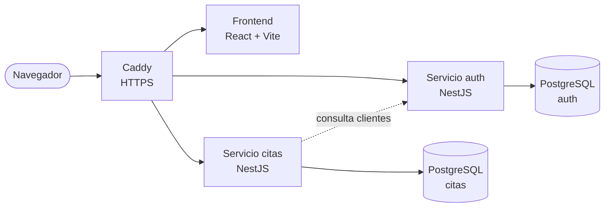

<div align="center">

# ✂️ Kanusi

**Web y sistema de citas para una barbería de estilo underground.**

_Lo que no se negocia: el estilo._


</div>

---

## Sobre el proyecto

Es la web de una barbería de mi pueblo. Tiene que estar online todo el año. Se pueden ver los servicios y precios, reservar cita y llevar la agenda. La hago yo solo y también me sirve para aprender (soy estudiante de 2º de DAW).

Dos cosas que tengo claras desde el principio:

- **Mobile-first.** Casi todos los clientes entrarán desde el móvil.
- **Quien llama por teléfono también tiene cita.** Si alguien no quiere usar la web, el barbero le crea la cita desde su cuenta.

## Qué hace (v1)

- Landing con servicios, precios, barberos, horarios y ubicación.
- Registro y login con correo y contraseña. El teléfono es obligatorio.
- Reservar cita en pasos: servicio, barbero, fecha y hora, y resumen.
- Citas para clientes sin cuenta, que crea el barbero o el admin.
- Lista de citas según el rol. Se puede filtrar entre pendientes y todas, y cancelar (el cliente hasta 6 h antes).
- Panel de cuenta: cambiar nombre, teléfono y contraseña.
- El admin elige varios días en un calendario y les pone horario. Si queda alguna cita fuera del horario nuevo, se la enseña para que llame al cliente.
- El admin da de alta a los barberos desde su panel.
- Política de privacidad y casilla obligatoria al registrarse (RGPD).

## Roles

| Rol               | Qué puede hacer                                                                                 |
| ----------------- | ----------------------------------------------------------------------------------------------- |
| **Visitante**     | Ver la landing y la política de privacidad                                                      |
| **Cliente**       | Reservar, ver y cancelar sus citas, cambiar sus datos y su contraseña                           |
| **Barbero**       | Ver sus citas y crear citas para otros clientes en su agenda                                    |
| **Barbero admin** | Lo mismo que el barbero, pero con todas las citas. Además define horarios y da de alta barberos |

## Arquitectura



| Servicio | Qué lleva                                                                                                             |
| -------- | --------------------------------------------------------------------------------------------------------------------- |
| `auth`   | Usuarios, registro, login, roles, cambio de contraseña, alta de barberos y búsqueda de clientes por teléfono o correo |
| `citas`  | Servicios y precios, barberos, horarios, citas y agenda                                                               |

Cada servicio tiene su propia base de datos. Todo va en un VPS con Docker Compose, Caddy para el HTTPS y GitHub Actions para el despliegue.

Los permisos se comprueban siempre en el backend. El frontend solo esconde lo que no toca a cada rol.

## Hoja de ruta

| Fase     | Contenido                                                                                                | Estado       |
| -------- | -------------------------------------------------------------------------------------------------------- | ------------ |
| **v0**   | Diseño, mapa del sitio y modelo de datos                                                                 | 🟡 En curso  |
| **v1.0** | Landing, política de privacidad, 404 y despliegue                                                        | ⬜ Pendiente |
| **v1.1** | `auth`: registro, login, roles, `/panel` y alta de barberos                                              | ⬜ Pendiente |
| **v1.2** | `citas`: servicios, horarios, reservas y cancelación, clientes sin cuenta                                | ⬜ Pendiente |
| **v1.3** | Mejoras y pulido                                                                                         | ⬜ Pendiente |
| **v2**   | Login con Google, modificar cita, recuperar contraseña, editar servicios desde la web, turnos de horario | 💡 Ideas     |

## Estructura del repositorio

```text
kanusi/
├── frontend/              # React + Vite + Tailwind
├── services/
│   ├── auth/              # Microservicio de usuarios (NestJS)
│   └── citas/             # Microservicio de citas (NestJS)
├── docs/
│   └── routes.md          # Mapa del sitio, rutas y permisos
├── docker-compose.yml
└── README.md
```

> Es la estructura que tengo prevista. Las carpetas las iré creando según avancen las fases.

## Documentación

- 🗺️ [Mapa del sitio, rutas y permisos](docs/routes.md): aquí están todas las páginas y quién puede entrar en cada una.

## Diseño

- **Herramientas:** FigJam para los wireframes y Figma para el diseño final.
- **Paleta:** `#dccc8d` (dorado) · `#b5b5b5` · `#ffffff` · `#616060` · `#0c0c0c`
- **Frames de referencia:** 390 px (móvil), 768 px (tableta) y 1440 px (escritorio).
- **Estado:** los wireframes de móvil de todas las pantallas de la v1 están hechos. Ahora toca montar el sistema de diseño en Figma.

## Convenciones

- **Idioma:** código, archivos y componentes en inglés. Textos visibles y rutas (URL) en español. Comentarios y documentación en español.
- **Commits:** [Conventional Commits](https://www.conventionalcommits.org/es/v1.0.0/) (`feat:`, `fix:`, `docs:`).
- **Ramas:** `feature/nombre-corto`, con pull request hacia `main`.

## Cómo ejecutarlo

Todavía no hay código. Estoy en la fase de diseño. Cuando llegue la v1.0 pondré aquí cómo instalarlo y desplegarlo.

## Autor

**brunobuendiadev**, estudiante de 2º de Desarrollo de Aplicaciones Web.

---

<div align="center">

© 2026 Kanusi

</div>
